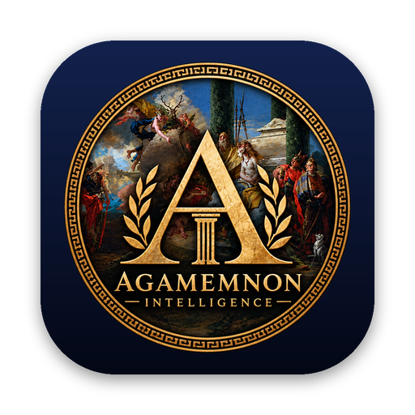

<div align="center">



# Agamemnon

**Free, open-source antivirus for macOS. Behaviour protection, pattern rules, a ransomware shield and 43 million known-malware fingerprints, in one quiet menu bar app.**

[](../../releases/latest)
[](../../releases)
[](#install)
[](LICENSE)
[](https://github.com/Agamemnon-Intelligence/Agamemnon-windows)

[How it works](HOW_IT_WORKS.md) · [Website](https://athenesoftworks.com) · [Windows version](https://github.com/Agamemnon-Intelligence/Agamemnon-windows)

</div>

---

## What it does

### Real-time protection

- **Behaviour protection.** Watches every new program and stops stealers, backdoors and miners as they run: fake password prompts, keychain, crypto-wallet and browser-data theft, secret screenshots, switching off macOS's download check, and downloads from known malware sites. Written against the families hitting Macs today: AMOS, Banshee, Cuckoo, Poseidon, FrigidStealer, SysJoker and others.
- **Ransomware shield.** Watches Documents, Desktop and Pictures (and any folders you add). If files suddenly start getting scrambled, it stops the unsigned program doing it and moves it to quarantine.
- **Download protection.** Every new download is checked as soon as it finishes, including inside archives and disk images, and against where it came from. Dangerous files go straight to quarantine.
- **Browser protection.** Finds adware extensions, search-engine hijacks and profiles that take over Safari, Chrome, Brave, Edge, Firefox, Arc, Opera or Vivaldi, with one-click removal.
- **Startup and admin alerts.** Warns you when something sets itself up to start automatically or asks for your administrator password, and regularly checks everything that already starts with your Mac.

### Scanning

- **Quick, Full, Custom and scheduled scans.** Drag and drop files or folders, or start a scan from the menu bar.
- **No hiding in archives.** Looks inside ZIP, RAR, 7Z, TAR, ISO, XAR, DMG and PKG files, up to 3 levels deep. Zip bombs are refused before anything is unpacked.
- **Quarantine vault.** Threats are moved, never deleted. Restore them or delete them for good: it's your call.

### Privacy and hardening

- **Encrypted DNS.** Cloudflare, Quad9, Mullvad or AdGuard over DNS-over-HTTPS for the whole Mac, with malware-blocking options.
- **Security Checkup.** FileVault, firewall, Gatekeeper, System Integrity Protection, automatic security updates, Remote Login and Time Machine, each with a button to the right setting.

## How detection works

A file only has to fail one check. Full details, including every rule and its limits, are in **[HOW_IT_WORKS.md](HOW_IT_WORKS.md)**.

| Engine | What it checks |
| --- | --- |
| **MalwareBazaar** | SHA-256 of every file against more than 1.1 million confirmed malware samples from [MalwareBazaar](https://bazaar.abuse.ch) (abuse.ch), updated twice a day. |
| **VirusShare** | MD5 of Mac programs (and, as a warning, installers and archives) against [VirusShare](https://virusshare.com/hashes)'s ~42.5 million malware hashes. Worked out in the same pass, so files are only read once. |
| **Pattern rules** | Tell-tale code and strings of Mac malware families in scripts and unsigned programs, so new builds are caught before anyone has listed them. |
| **Behaviour rules** | What a program does once it runs: about two dozen narrow rules for stealers, spyware, backdoors and miners. |
| **URLhaus** | Where a download came from, against [URLhaus](https://urlhaus.abuse.ch)'s live list of malware links (abuse.ch). |
| **ClamAV** | Cisco's free engine as a second opinion. Agamemnon installs it for you and keeps its own signatures up to date. |
| **Gatekeeper** | Whether downloaded apps and installers are signed and notarized. Revoked developer certificates count as malware. |

Agamemnon is careful not to cry wolf. It never stops or quarantines anything that's part of macOS or signed by a known developer on its own, and its rules were checked against more than 1.5 million files on an everyday Mac without a false alarm.

## Install

1. Download **`Agamemnon.dmg`** from the [latest release](../../releases/latest). The [Nightly build](../../releases/tag/nightly) has the newest changes from `main`.
2. Open it and drag **Agamemnon** to **Applications**.
3. The first time you open it, macOS may block it because this build is ad-hoc signed. Go to **System Settings › Privacy & Security** and click **Open Anyway**.
4. For full scans, give Agamemnon **Full Disk Access** in System Settings › Privacy & Security.

**On first launch** Agamemnon downloads its malware lists in the background: MalwareBazaar (about 45 MB), URLhaus (about 3 MB) and VirusShare (about 1.4 GB, picked up again if interrupted). It also installs ClamAV, through Homebrew if you have it, otherwise with Cisco's signed installer after one password prompt. Altogether it uses about 1 GB of disk space. You can turn VirusShare and ClamAV off in Settings.

## Privacy

- **No account, no telemetry, no uploads.** Your files never leave your Mac. Only fingerprints are compared, against lists stored on your Mac.
- **Network use** is limited to downloading the malware lists above, ClamAV and its signatures, and the creators' profile pictures on the About page.
- **Not sandboxed.** An antivirus has to read the whole disk and run system tools, which Apple's App Sandbox doesn't allow. The app runs with Hardened Runtime.

## Limits

No antivirus catches everything. Agamemnon is honest about what it can't do:

- **It reacts just after things start, not before.** Behaviour protection, download protection and the ransomware shield act within a second or two. Blocking a file or program *before* it runs needs Apple's Endpoint Security entitlement, which this build doesn't have. Keep a Time Machine backup.
- **Known-malware lists only know what's been reported.** Pattern rules, behaviour rules and ClamAV catch many new builds, but brand-new or heavily disguised malware can still get past.
- **Signed malware** is only caught by hash, ClamAV or behaviour until Apple revokes its certificate.
- **Files that are only in iCloud Drive** (not downloaded to the Mac) are skipped until they're downloaded.
- **Encrypted DNS** needs your approval in System Settings, and **admin alerts** need an administrator account.

Keep macOS up to date and only install software you trust.

## Build

The Xcode project is generated with [XcodeGen](https://github.com/yonaskolb/XcodeGen). You need the latest Xcode; the app runs on macOS 13 or later.

```sh
brew install xcodegen
xcodegen generate
open Agamemnon.xcodeproj
```

Before changing detection, quarantine, real-time protection or DNS, read [HOW_IT_WORKS.md](HOW_IT_WORKS.md) and the rules in [AGENTS.md](AGENTS.md).

### Releases

GitHub Actions (`.github/workflows/build.yml`) builds a universal app and DMG on every push:

- **Every push to `main`** updates the **Nightly build** release.
- **Pushing a tag that starts with `v`** (for example `v2.25`) creates a versioned release with the DMG attached. Set `MARKETING_VERSION` in `project.yml` first.

To ship a signed and notarized DMG instead of an ad-hoc one, add these repository secrets:

- `DEVELOPER_ID_P12`: your Developer ID Application certificate, as a base64-encoded .p12
- `DEVELOPER_ID_P12_PASSWORD`: the password for that .p12
- `APPLE_ID`, `APPLE_TEAM_ID` and `APPLE_APP_PASSWORD`: for notarization

## Agamemnon for Windows

The Windows app lives in its own repository: **[Agamemnon-Intelligence/Agamemnon-windows](https://github.com/Agamemnon-Intelligence/Agamemnon-windows)**. It has its own pattern rules, malware-site checks and signature checks. Downloads, build instructions and issues for Windows are there.

## Credits

Created by [mirazbakis](https://github.com/mirazbakis) and [mertyesileducation](https://github.com/mertyesileducation), [Athene Softworks](https://athenesoftworks.com).

Malware hashes come from MalwareBazaar (abuse.ch) and VirusShare, and malware links from URLhaus (abuse.ch). The second engine is ClamAV by Cisco Talos. The emblem is built around *The Sacrifice of Iphigenia* by Giovanni Battista Tiepolo, which is in the public domain.

## License

Agamemnon is free software, released under the [GNU General Public License v2.0](LICENSE).

**Copyright (C) 2026 mirazbakis and mertyesileducation**
